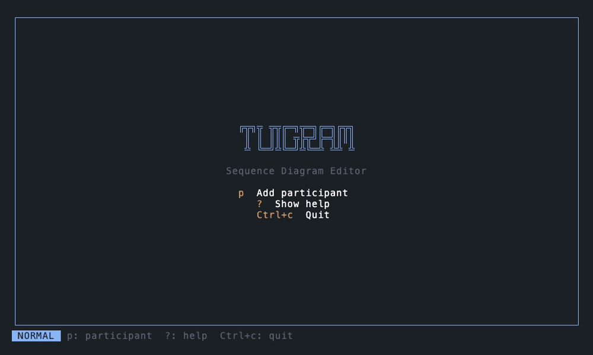

<h1 align="center">Tuigram</h1>

<p align="center">
  <a href="https://crates.io/crates/tuigram"></a>
  
  <a href="https://github.com/preiter93/tuigram/actions/workflows/ci.yml"></a>
  <a href="https://deps.rs/repo/github/preiter93/tuigram"></a>
  <a href="./LICENSE"></a>
</p>

<p align="center">
  
</p>

<p align="center"><em>A TUI sequence diagram editor.</em></p>

## Installation

<details>
<summary><b>Homebrew</b></summary>

```
brew install preiter93/tuigram/tuigram
```
</details>

<details>
<summary><b>Cargo</b></summary>

```
cargo install tuigram
```
</details>

<details>
<summary><b>Nix</b></summary>

```
nix run github:preiter93/tuigram
```
</details>

<details>
<summary><b>Pre-built binaries</b></summary>

Download from [GitHub Releases](https://github.com/preiter93/tuigram/releases)
</details>

## Keybindings

| Key | Action |
|-----|--------|
| `p` | Add participant |
| `m/M` | Insert message after/before selected |
| `n/N` | Insert note after/before selected |
| `b/B` | Add/remove box around participants |
| `h/l` or `←/→` | Navigate left/right (participants) |
| `j/k` or `↓/↑` | Navigate down/up (messages/notes) |
| `H/L` or `Shift+←/→` | Move participant left/right, reverse message arrow |
| `a/A` | Cycle message arrow style forward/backward |
| `J/K` or `Shift+↓/↑` | Move message/note up/down* |
| `Enter` | Edit selected |
| `r` | Rename selected (participant: display name) |
| `t` | Toggle participant/actor |
| `D` | Delete selected |
| `C` | Clear diagram |
| `u` / `U` or `Ctrl+r` | Undo / redo (up to 100 steps) |
| `E` | Save to file (opened file, else `diagram.mmd`) |
| `S` | Save as (prompts for a path) |
| `y` | Copy Mermaid to clipboard |
| `?` | Help (any key closes it) |
| `Ctrl+c` | Quit (asks if there are unsaved changes) |

> \* `Shift+↑/↓` may not work in all terminals, some intercept these for scrollback. Use `J`/`K` instead.

## Mermaid

### Open / Save

```
tuigram diagram.mmd
```

`--import diagram.mmd` still works. A missing file starts an empty diagram and is created on save. Press `E` to save back to the opened file (default `diagram.mmd`); a `[+]` marker in the status bar shows unsaved changes. `S` asks for a new path (`~` is expanded, missing directories are not created, an existing file is overwritten without asking) and makes it the save target for later `E` presses. Saving rewrites the file in canonical format, so `%%` comments, blank lines and custom formatting are dropped.

Blank lines and `%%` comments are ignored; unsupported syntax is reported with its line number.

Participant aliases (`participant A as Alice`) and `actor` declarations are supported.

## Clipboard

`y` copies the diagram as Mermaid text using the OSC 52 terminal escape sequence. The terminal gives no confirmation, so "Copied N lines" only means the sequence was sent. Terminal.app ignores OSC 52, tmux needs `set -g set-clipboard on`, and some terminals limit the size or ask before accepting it.
